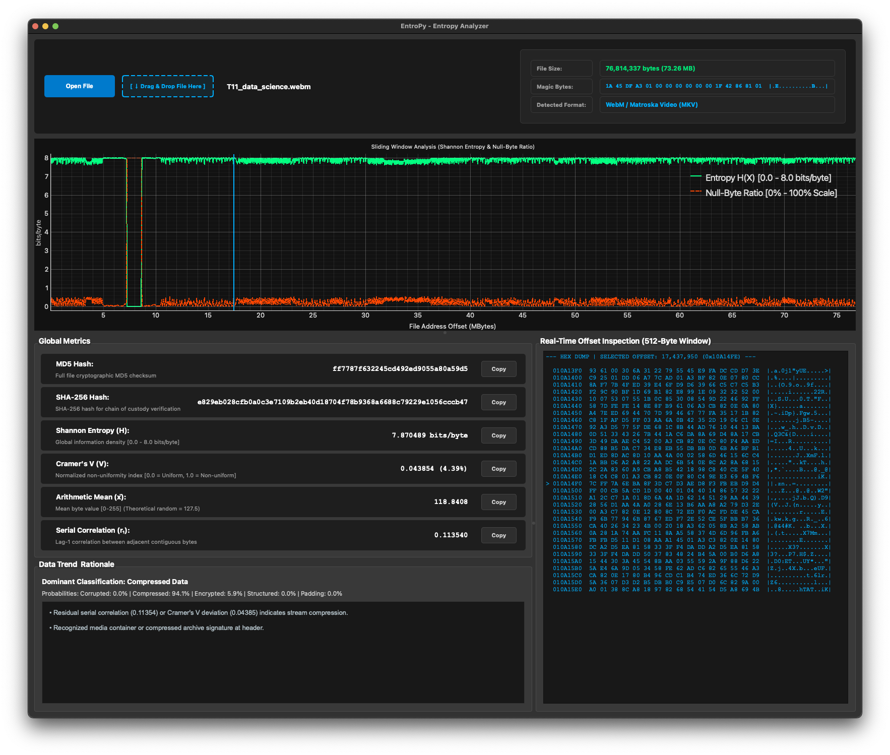

# EntroPy - Forensic Entropy & Randomness Analyzer


**EntroPy** is a high-performance, cross-platform forensic tool engineered for deep entropy analysis, byte distribution profiling, and structural randomness detection in binary files. It leverages memory-mapped file processing, vectorized NumPy operations, and GPU-accelerated Qt graphing to deliver real-time sliding-window visualizations for files of arbitrary size without overloading system memory.

---

## Key Features

* **Memory-Mapped Vectorized Processing:** Employs `mmap` combined with NumPy stride tricks to slice and analyze multi-gigabyte binaries efficiently in non-blocking batches.
* **Normalized Statistical Engine:**
  * **Shannon Entropy ($H$):** Measures global and local information density ($0.0 \text{ to } 8.0 \text{ bits/byte}$).
  * **Cramér's V ($V$):** Evaluates non-uniformity as a size-independent normalized metric ($0.0 \text{ to } 1.0$).
  * **Lag-1 Serial Correlation ($r_1$):** Detects contiguity dependencies and pattern repetition between adjacent bytes.
  * **Lag-2 Pair Correlation ($r_2$):** Detects alternating/multi-byte periodic structures invisible to lag-1 analysis.
  * **Arithmetic Mean ($\bar{x}$):** Assesses global distribution bias relative to uniform theoretical randomness ($\bar{x} = 127.5$).
* **Stream Corruption & Zero-Filling Detection:** Automatically identifies localized entropy drops and anomalous padding blocks within compressed/encrypted data streams (e.g., damaged WebM, MKV, or ZIP archives).
* **Magic Bytes Header Recognition:** Auto-detects file signatures via an external, easily-extensible table (`magic_signatures.json`, ~60 formats) with offset-aware matching (tar at byte 257, ISO-BMFF at byte 4, DICOM at 128, RIFF subtypes, …); a small embedded fallback keeps identification working if the JSON is missing, so no dependency is required.
* **Synchronized 512-Byte Region Highlight:** Clicking anywhere on the time-series plot projects a semi-transparent $512\text{-byte}$ region highlight on the graph that locks directly to the real-time Hexadecimal/ASCII inspection pane.
* **Asynchronous Execution Architecture:** Multi-threaded worker queue (`QThread`) providing continuous percentage updates via a UI progress overlay frame during initial file intake.
* **Multi-File Batch Analysis:** Drop several files at once (or select them via *Open Files*) to analyze them sequentially in a single run, with a per-file classification summary and isolated per-file error handling.
* **One-Click JSON Report Export:** Save the complete `AnalysisReport` (metadata, hashes, metrics, windowed series, trend & rationale) as a portable `.entroPy.json` document for forensic evidence chains.
* **Modern High-DPI Desktop Interface:** Drag-and-drop file loading, zoom boundary protection, card-style metric rows with inline sub-descriptions, and one-click clipboard copy functionality.

---

## Graphical User Interface Overview


<p align="center">
  
</p>


```text
+-----------------------------------------------------------------------------------+
|  [Open File]  [ ⇩ Drag & Drop File Here ]  file_sample.bin                        |
|  -------------------------------------------------------------------------------  |
|  File Size: 76,814,337 bytes (73.26 MB) | Magic Bytes: 1A 45 DF A3... | WebM/MKV  |
+-----------------------------------------------------------------------------------+
|                                                                                   |
|  SLIDING WINDOW PLOT (PyQtGraph)                                                  |
|  - Shannon Entropy Curve (Green + 15% Translucent Fill)                           |
|  - Null-Byte Ratio Overlay (Orange Dashed Line)                                   |
|  - 512-Byte Region Highlight Box (Cyan Semi-Transparent)                          |
|                                                                                   |
+--------------------------------------------------+--------------------------------+
| GLOBAL METRICS & TREND                           | REAL-TIME OFFSET INSPECTION    |
| - MD5 / SHA-256 Hashes (One-click copy)          | 512-Byte Monospace Hex Dump    |
| - Shannon Entropy H(X) & Cramér's V (V)          | Formatted Hex & ASCII Views    |
| - Arithmetic Mean & Serial Correlation           | Offset Line Marker Pointer (>) |
| - Probabilities & Red Critical Anomaly Rationale | Synchronized to Plot Clicks    |
+--------------------------------------------------+--------------------------------+
```

---

## Mathematical Foundations

### 1. Shannon Entropy
Measures the average information content or unpredictability per byte in a discrete probability distribution:

$$H(X) = -\sum_{i=0}^{255} P(x_i) \log_2 P(x_i)$$

* **$H(X) \approx 0.0$:** Highly repetitive or uniform stream (e.g., zero-padded memory dumps).
* **$H(X) \approx 8.0$:** Maximum entropy, indicating compressed, encrypted, or purely random data.

### 2. Cramér's V (Normalized Non-Uniformity Index)
While standard Chi-Square ($\chi^2$) metrics scale linearly with file size $N$ (yielding values in the millions for large binaries), **Cramér's V** normalizes the deviation independently of file length:

$$V = \sqrt{\frac{\chi^2}{255 \cdot N}}$$

| Cramér's V Value | Statistical Interpretation | Common File Types |
| :--- | :--- | :--- |
| **$V \le 0.005$ ($0.5\%$)** | High Uniformity / Randomness | Encrypted volumes, `/dev/urandom`, AES streams |
| **$0.005 < V \le 0.05$ ($0.5\% - 5.0\%$)** | Low Deviation | Compressed containers (ZIP, WebM, PNG, ZSTD) |
| **$0.05 < V \le 0.30$ ($5.0\% - 30.0\%$)** | Moderate Deviation | Executables (PE, ELF), compiled code, databases |
| **$V > 0.30$ ($> 30.0\%$)** | High Non-Uniformity | Plain text, zero-padded streams, corrupted data |

> **Note:** Like all chi-square normalizations, Cramér's V decays as $1/\sqrt{N}$ for truly uniform streams (a random 1 MB file typically measures $V \approx 0.001$). The thresholds above are therefore most meaningful for files of $\gtrsim 10\,\mathrm{KB}$; for larger files even minor deviations from uniformity accumulate, which is exactly what the heuristic exploits.

### 3. Lag-1 Serial Correlation
Measures linear dependency between adjacent byte pairs $(x_i, x_{i+1})$ across the binary file:

$$r_1 = \frac{\sum_{i=1}^{N-1} (x_i - \bar{x})(x_{i+1} - \bar{x})}{\sum_{i=1}^{N} (x_i - \bar{x})^2}$$

* **$r_1 \approx 0.0$:** Uncorrelated byte sequences.
* **$r_1 > 0.1$:** Residual pattern structure typical of uncompressed or partially corrupted streams.
* **$r_2 \approx 1.0$ with $r_1 \approx -1.0$:** Alternating two-byte periodicity (e.g., interleaved streams) that lag-1 alone would misread as pure anti-correlation.

### 4. Lag-2 Pair Correlation
Extends the serial-correlation model to bytes two positions apart, exposing alternating and other short-period structures:

$$r_2 = \frac{\sum_{i=1}^{N-2} (x_i - \bar{x})(x_{i+2} - \bar{x})}{\sqrt{\sum (x_i - \bar{x})^2 \sum (x_{i+2} - \bar{x})^2}}$$

Both correlations are computed with streaming two-pass reductions over 4 MiB chunks, keeping peak memory constant regardless of file size.

---

## Installation & Requirements

### System Prerequisites
* **Operating System:** macOS 11+, Linux (Ubuntu/Debian/Fedora/Arch), or Windows 10/11.
* **Python Runtime:** Python `3.10` or higher.

### Step-by-Step Environment Setup

1. **Clone the Repository:**
   ```bash
   git clone https://github.com/cuarentaysiete/entroPy.git
   cd entroPy
   ```

2. **Create and Activate a Dedicated Virtual Environment:**
   ```bash
   python3 -m venv entropy_env
   source entropy_env/bin/activate
   ```
   *(On Windows, activate using `entropy_env\Scripts\activate`)*

3. **Install Required Dependencies:**
   ```bash
   pip install -r requirements.txt
   # or, for the `entroPy` console command and the test suite:
   pip install -e ".[dev]"
   ```

---

## Usage Guide

### Graphical Interface

Run `gui.py` from your activated virtual environment:

```bash
python gui.py
```

### Command-Line Interface (headless)

`core.py` doubles as a CLI for scripting, forensics triage, or CI pipelines:

```bash
python core.py /path/to/file.bin            # human-readable summary
python core.py file.bin --json              # full machine-readable report
python core.py file.bin --block-size 8192 --stride 8192   # custom window
```

The JSON report mirrors the GUI's `AnalysisReport` dataclass (metadata, global metrics, windowed series, trend + rationale).

### Analyzing Files
1. **Intake:** Click **Open Files** or drag and drop one or more files onto the interface. Multiple dropped files are analyzed sequentially in a single run, with a per-file classification summary and global progress.
2. **Progress:** Monitor the real-time percentage progress bar on the overlay pane during calculations.
3. **Graph Interaction:**
   * **Left-Click:** Select any offset on the time-series plot to display the corresponding $512\text{-byte}$ region highlight on the graph and view the aligned hexadecimal dump below.
   * **Right-Click Drag / Scroll Wheel:** Zoom into localized offset regions. Zoom out is bounded to prevent view displacement beyond valid memory offsets ($0.0 \text{ to } 8.2$).
4. **Copying Metrics:** Click the **Copy** button alongside any cryptographic hash or global statistical parameter to store the precise value in your clipboard.
5. **Exporting:** Click **Export Report (JSON)** to save the complete analysis of the selected file as a `.entroPy.json` document (machine-readable, suitable for evidence chains and automation).

---

## Repository Structure

```text
entroPy/
├── core.py         # Computational statistics engine, memory-mapping, heuristics & CLI
├── gui.py          # PySide6 desktop interface, PyQtGraph views & interactive event logic
├── magic_signatures.json  # External file-signature table (edit to add formats, no code changes)
├── pyproject.toml  # Packaging: dependencies, `entroPy` console entry point, dev extras
├── requirements.txt# Pinned-less runtime dependencies for manual installs
├── tests/
│   ├── conftest.py     # Test bootstrap (repo on sys.path, offscreen Qt)
│   ├── test_core.py    # Engine unit tests: statistics, heuristics, export, CLI
│   └── test_gui.py     # Headless Qt smoke tests (skipped if PySide6 missing)
├── .github/
│   └── workflows/ci.yml# GitHub Actions: pytest on Linux/macOS/Windows, Py 3.10–3.13
├── .gitignore
├── LICENSE         # MIT License declaration
└── README.md       # Project documentation
```

### Running the Tests

```bash
pip install -e ".[dev]"
python -m pytest
```

### Building the macOS App

Two ways to get a double-clickable `entroPy.app`:

1. **GitHub Actions (no local tooling needed):** in the repo's *Actions* tab, run the
   **Build macOS App** workflow, wait a few minutes, and download the artifact
   `entroPy-macos-arm64` — **Apple Silicon only** (GitHub retired hosted Intel
   runners). Unzip and drag the `.app` into *Applications*.
   For **Intel Macs**, use the local build below.

2. **Locally (any Mac):** `pip install -e . pyinstaller && pyinstaller entroPy.spec`
   → `dist/entroPy/entroPy.app`.

The app is **not code-signed/notarized**: the first launch will be blocked by
Gatekeeper — click the right mouse button → *Open* once (or run
`xattr -dr com.apple.quarantine /Applications/entroPy.app`), then it runs
normally. If you hold an Apple Development certificate, run
`codesign --deep --sign "Developer ID Application: ..." dist/entroPy/entroPy.app`
before zipping.

---

## License

Distributed under the **MIT License**. See `LICENSE` for complete licensing terms and copyright details.